<a id="top"></a>

<div align="center">

  

  <h1>🛍️ Fantasy Shop</h1>

  <h3>A multi-page online store demo built with HTML, CSS, and vanilla JavaScript.</h3>

  <p>
    <a href="https://nitzanm23.github.io/fantasy-shop/">
      
    </a>
  </p>

  <p>
    
    
    
    <a href="https://github.com/nitzanm23/fantasy-shop/actions/workflows/ci.yml">
      
    </a>
  </p>

</div>

<p align="center">
  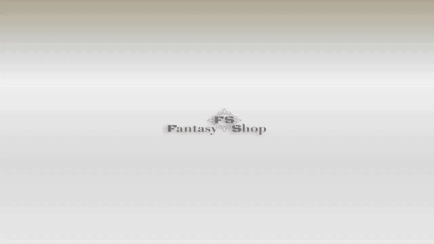
</p>

---

## 🎯 Overview

**Fantasy Shop** is a 15-page storefront for a fictional brand, built as a portfolio project with semantic HTML, modular CSS, and vanilla JavaScript.

The home page and product cards follow the kunaal438 e-commerce tutorial credited below. I expanded it into a full site: product, search, sign-up, log-in, profile, about, careers, contact, four legal pages, and a 404 page. All pages share one navbar and footer component.

> **Demo scope:** A static front end with no backend, accounts, payments, or real search. The cart, wishlist, social login, and language switch show a short "demo only" message, and the forms move to the next page without sending any data. The team, contact details, and policies are fictional: emails use the reserved `.example` domain, and the legal pages are marked as sample text.

---

## ✨ Features

- **Shared navigation:** One navbar and footer for all 15 pages, with account, cart, and language dropdowns and a mobile menu.
- **Product browsing:** Best sellers and new arrivals carousels, collection cards, a product page with an image gallery and size selector, and a search results grid.
- **Account and company pages:** Sign-up and log-in forms, a user profile, about, careers, contact (with a map), and privacy, terms, cookies, and security pages.
- **Background videos:** Hero videos on seven pages, each with a Pause/Play button.
- **Branded opening screen:** A short logo intro on the home page that never blocks content without JavaScript.

---

## 🧠 Technical Highlights

- **Accessible navigation:** The dropdowns follow the disclosure pattern (`aria-expanded`, Escape, outside click). While the mobile menu is open, the rest of the page is `inert`. The closed menu is hidden from the tab order, and focus returns to the toggle.
- **Motion that respects people:** `prefers-reduced-motion` stops the videos and carousels. Carousels pause on hover and focus, and stop for good after a manual click or touch. Every video has a pause button (WCAG 2.2.2).
- **Honest demo behavior:** One delegated listener shows an `aria-live` notice for any control marked `data-demo`. Form fields have no `name`, so no password ever ends up in the URL.
- **Media budget:** I re-encoded the videos from 126 MB to 22 MB and resized the images to their display size (26 MB to 2 MB). The font is self-hosted, and the 28 icons ship as one SVG sprite instead of a full icon font.
- **Shared components without a build step:** `nav.js` and `footer.js` render the navbar and footer into every page. The trade-off: without JavaScript, page content stays fully visible, but the navbar and footer don't appear.

---

## 🧰 Tech Stack

- **HTML5 & CSS3:** custom properties, BEM, Grid, Flexbox, media queries
- **Vanilla JavaScript:** small focused scripts, no framework or build step
- **Fredoka:** self-hosted variable font in `vendor/fonts/`
- **Font Awesome Free 6.7.2:** 28 icons in one SVG sprite (`assets/icons/icons.svg`)
- **flag-icons:** two flag SVGs for the language menu
- **GitHub Actions:** HTML validation, Lighthouse CI, and GitHub Pages deployment

---

## 📁 Project Structure

```text
fantasy-shop/
├── index.html, product.html, search.html, …   # 15 pages
├── manifest.webmanifest  # home screen name, colors, and icons
├── assets/
│   ├── icons/            # favicon, home screen icons, icon sprite, flags, UI icons
│   ├── images/           # photos grouped by page, social preview image
│   ├── logos/
│   └── videos/           # background videos and their poster frames
├── styles/
│   ├── tokens.css        # design tokens (colors, spacing, motion, layers)
│   ├── reset.css         # browser defaults, focus ring, reduced motion
│   ├── layout.css        # global styles, utilities, icons, skip link, demo notice
│   ├── general.css       # components shared across pages
│   ├── nav.css, footer.css
│   └── …                 # one stylesheet per page or page group
├── scripts/
│   ├── nav.js            # navbar: dropdowns, mobile menu, scroll state
│   ├── footer.js         # footer
│   ├── demo-notice.js    # "demo only" messages
│   ├── background-video.js
│   ├── product-carousel.js
│   ├── product.js        # product gallery and size selector
│   └── page-loader.js    # home page opening screen (runs before first paint)
├── vendor/               # self-hosted font and license files
├── docs/                 # README screenshots, demo GIF, signatures
└── .github/              # CI workflow, html-validate and Lighthouse settings
```

---

## 🚀 Getting Started

### Run locally

Clone the repository, open a terminal in the project folder, and start a static server:

```bash
python3 -m http.server 8000
```

Then open `http://localhost:8000`. No `npm install` or build step is needed. Opening the files directly (`file://`) breaks the icons in Chromium-based browsers, which block external SVG sprites there.

### CI & deployment

Every push and pull request runs [`ci.yml`](.github/workflows/ci.yml): `html-validate` checks all 15 pages, and Lighthouse CI checks four representative pages and fails the run if Accessibility, Best Practices, or SEO drop below 95. Pushes to `main` that pass are deployed to GitHub Pages, publishing only the runtime files.

### Testing

Checked in Chrome on all 15 pages at five widths (360–1440px), including keyboard-only navigation, reduced motion, and JavaScript disabled. Results: no console errors or layout overflow, 0 axe-core violations at desktop and mobile widths, and a Lighthouse Accessibility score of 100 on the four pages CI checks.

---

## 📸 Screenshots

<table>
  <tr>
    <td width="64%" valign="top">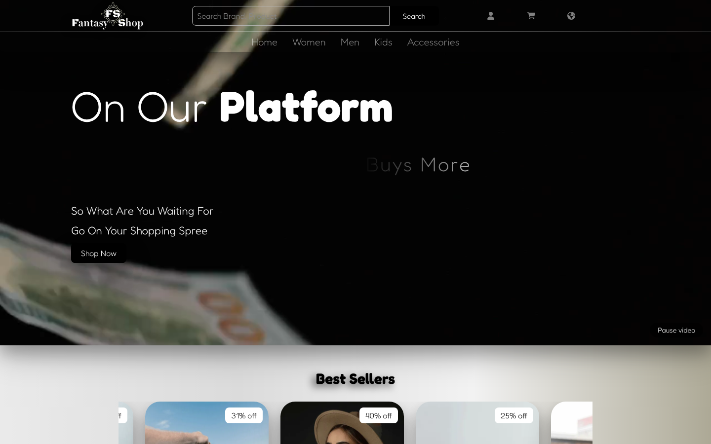</td>
    <td width="18%" valign="top">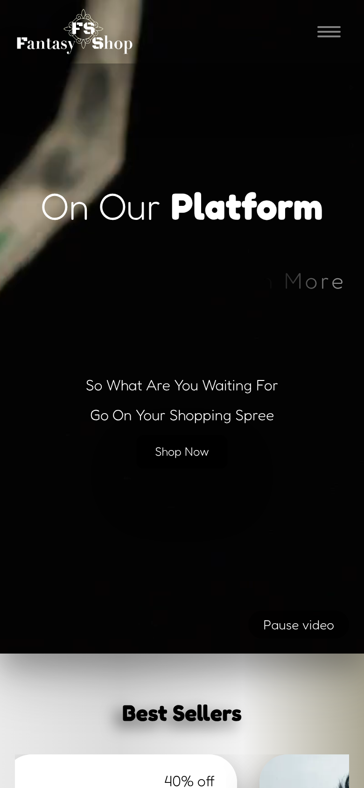</td>
    <td width="18%" valign="top">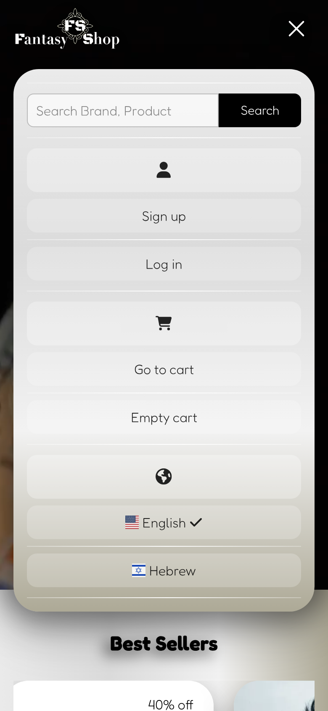</td>
  </tr>
</table>

<details>
  <summary>More pages (product, log in, about, search, 404)</summary>
  <br />
  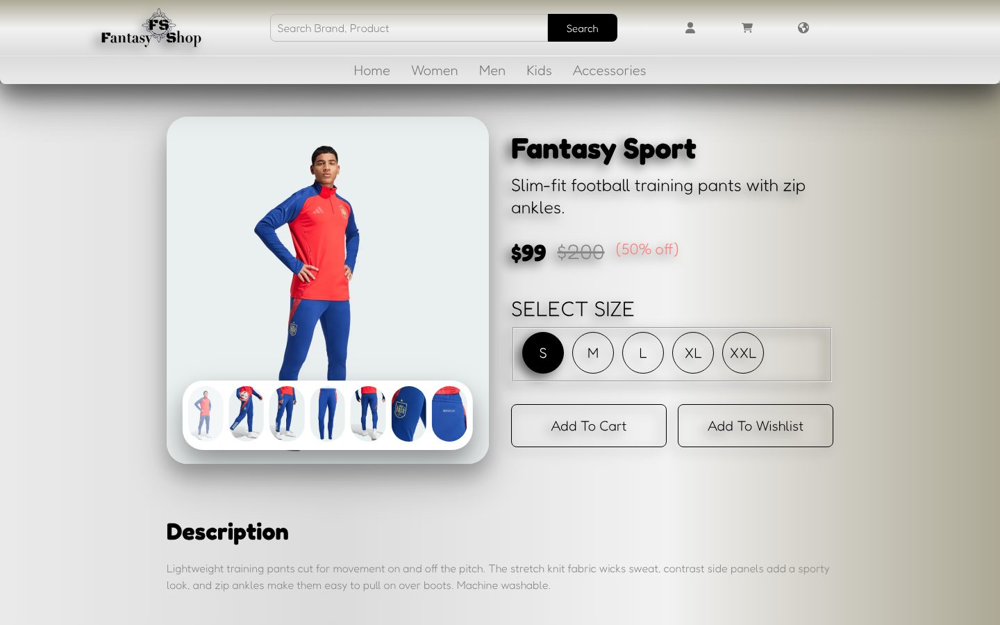
  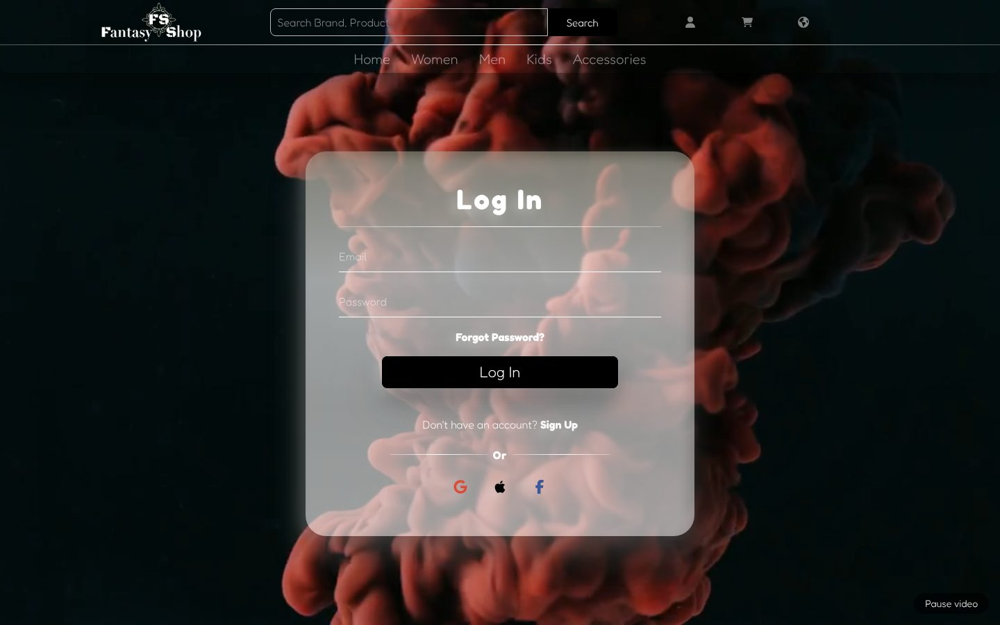
  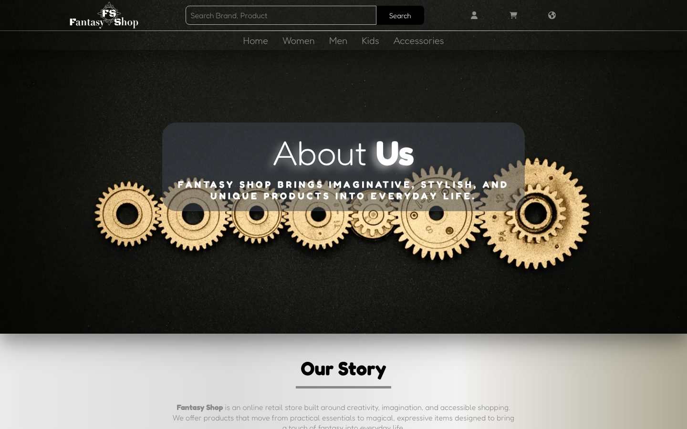
  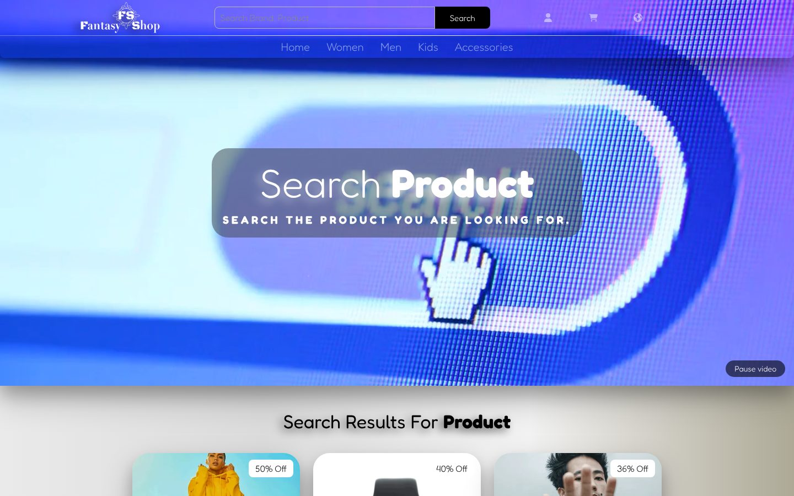
  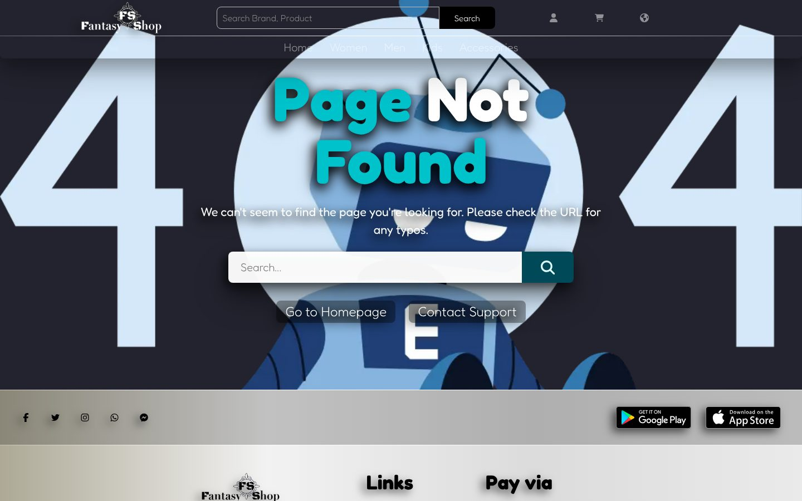
</details>

<details>
  <summary>Full-page captures of the home page (desktop, mobile)</summary>
  <br />
  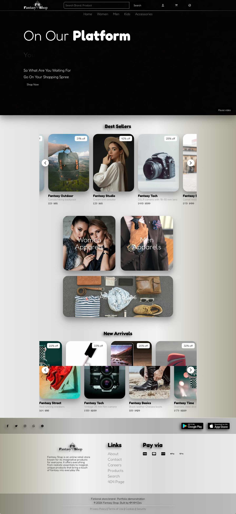
  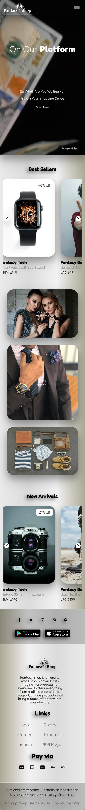
</details>

---

## 🔭 Possible Improvements

- Render the navbar and footer at build time, so they also appear without JavaScript.
- Load products from a JSON file to power real search, filtering, and a `localStorage` cart.
- Serve responsive image sizes (`srcset`) so phones download smaller photos.

---

## 🙏 Credits & License

- **Tutorial:** [How to make an e-commerce website with HTML, CSS and JS](https://dev.to/kunaal438/how-to-make-an-e-commerce-website-with-html-css-and-js-3aon) by kunaal438 (Modern Web).
- **Photos & videos:** From the original project files; their sources are not documented. The product page photos show a real brand's football kit, and the brand names on the site are fictional.
- **Libraries & fonts:** Fredoka (OFL 1.1), Font Awesome Free icons (CC BY 4.0), and flag-icons (MIT). License files are in `vendor/`.
- **License:** My own code is released under the [MIT License](LICENSE). Third-party assets above keep their own terms.

---

## 👤 About Me

<div align="center">

  <h3>NM Dev · Nitzan Mizrachi</h3>

  <p>
    <a href="https://nm-dev.com">
      
    </a>
    <a href="https://www.linkedin.com/in/nitzan-mizrachi/">
      
    </a>
    <a href="mailto:nitzanm23@gmail.com">
      
    </a>
    <a href="https://github.com/nitzanm23">
      
    </a>
  </p>

  <table align="center">
    <tr>
      <td align="center">
        
      </td>
      <td align="center">
        
      </td>
    </tr>
  </table>

  <p><a href="#top">⬆ Back to top</a></p>

</div>
